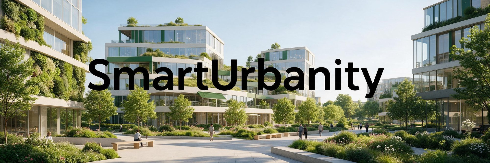
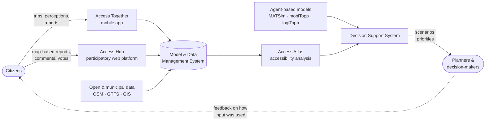
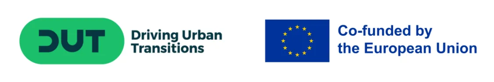

  

### Advancing 15-Minute Cities through Collaborative and Smart Urban Solutions

**Citizen-centric digital tools for inclusive, accessible 15-minute cities**

---

## About the project

SmartUrbanity is a 36-month research and innovation project under the **Driving Urban Transitions (DUT) Partnership**. It aims to make the 15-minute city, where everyday services can be reached within a short walk, cycle or public transport trip, **measurable, inclusive and actionable**.

Most accessibility indicators only measure distance and travel time. SmartUrbanity starts from the observation that accessibility is also shaped by how a trip *feels*: safety, comfort, reliability, physical effort and personal circumstances. The project therefore combines objective network analysis with citizen-reported experience, and turns both into evidence that planners and decision-makers can use.

SmartUrbanity builds on earlier European tools such as GOAT (accessibility analysis) and WeCount (citizen science), adding granular, up-to-date citizen data, machine learning and agent-based simulation. It pursues two goals of the DUT 15-minute city pathway: **bridging disparities** by establishing equitable 15-minute zones, and **enhancing collaboration** by combining planners' expertise with community insight.

The work rests on a human-centred accessibility framework with five dimensions:

| Dimension | What it captures |
|---|---|
| **Proximity** | Physical distance to services |
| **Time** | Temporal availability and variation |
| **Opportunity** | Relevance and quality of the services that can be reached |
| **Perception** | Subjective experience of moving: stress, comfort, safety |
| **Attitude** | Individual preferences and dispositions, such as openness to active modes |

## The SmartUrbanity toolkit

The digital tools form one ecosystem that links citizen-generated data to evidence-based planning.

| Tool | Role |
|---|---|
| 📱 **Access Together** (Citizen Engagement App) | Mobile app for recording trips, pre- and post-trip questionnaires, and geo-referenced reports on safety, accessibility and comfort. Includes an optional gamification layer (points, badges, campaigns) to sustain participation. |
| 🗺️ **Access Lab** (Accessibility Analysis Platform) | Web platform with two parts. **Access Hub** collects map-based, deliberative input: barrier reports, comments, verification and voting. **Access Atlas** computes and visualises accessibility to everyday services (health, education, mobility, leisure, daily needs) for different user profiles and mobility conditions. |
| 🎯 **Decision Support System (DSS)** | The decision-support function of the platform. It aggregates citizen input with objective indicators so authorities can compare baseline and intervention scenarios, and prioritise measures by cost, urgency, expected outcome and impact on disadvantaged groups. It works only on aggregated, anonymised data. |
| 🛴 **Micro-Mobility Integration App (MIMA)** | CTLup's complementary app, integrated with the DSS at scale-up, for micro-mobility, vulnerable road users and logistics: route guidance, heat maps, incident reporting and real-time alerts. |

**Gamification.** The proposal foresees a dual scoring system: *Green Points* for sharing trip data, with more points for sustainable trips, redeemable for cultural and sports incentives; and *Yellow Points* for location-based contributions and campaign participation, which users can direct to community projects. Badges mark personal milestones. Following the 2026 stakeholder workshops, gamification is designed to be optional and non-competitive, and is introduced subject to ethics and privacy review.

**Inclusive participation.** Besides the app, people can take part through workshops, focus groups, interviews and paper-based surveys, so that people with limited digital access are not left out.

### Modelling approach

- **Perceived effort–weighted routing.** Each network link gets a user-specific cost that combines baseline travel time with physical and experiential factors (slope, surface, lighting, perceived safety):

  $$C_u(a) = \tau_a \cdot \alpha_u + \sum_i p_{i,a}\,(\beta_{u,i} + \gamma_{u,i})$$

  where $\alpha_u$ is the user's mobility-ability multiplier, $\beta_{u,i}$ and $\gamma_{u,i}$ are sensitivities to infrastructure and emotional burden, and $p_{i,a}$ is the presence or intensity of feature $i$ on link $a$. The coefficients are calibrated from app data and surveys.
- **Doubly-constrained gravity model** to analyse zone-to-service accessibility and spatial equity under different user profiles and time scenarios.
- **User personas** that combine socio-demographic, perceptual and attitudinal data, so scenarios can be evaluated from the perspective of different groups.
- **Machine learning:** mode-detection algorithms that distinguish trip stages from GPS and sensor data, and models that predict mobility needs, accident severity and the urgency of interventions.
- **Agent-based simulation:** mobiTopp and logiTopp (passenger and freight demand, Karlsruhe) and MATSim (Lyon and Greater Zurich Area), including an optimisation model for integrating demand-responsive transport (DRT) with conventional public transport.
- **Hybrid AI (HAI) models** that combine simplified physics-based models with data-driven corrections, bringing climate factors such as temperature, wind and air quality into decision-making (Lyon pilot).

### Privacy by design

Data is collected voluntarily and only from adult participants (18+). The Model and Data Management System separates identity and consent data from pseudonymised analytics data and from the aggregated public outputs, and supports compliance with **GDPR** (Italy, Germany, France), the Swiss **FADP** and Türkiye's **KVKK**.

## Pilot areas

The toolkit is tested in five European pilot areas chosen for their different density, income, age structure, car dependency and transport access. The Access Together app will also be deployed in **Budapest (Hungary)** to build a shared dataset across countries.

| Pilot area | Area | Population | Density (/km²) | Car use | Pilot lead | Local partners |
|---|---:|---:|---:|---|---|---|
| 🇮🇹 **Rome**, Municipio XII | 73 km² | 140,000 | 1,925 | Very high | Movesion | Municipio XII of Rome; Rome Citizens' Consultation for Road Safety, Active Mobility and Sustainability |
| 🇩🇪 **Karlsruhe** | 173 km² | 310,000 | 1,780 | Medium | KIT | City of Karlsruhe; KVV |
| 🇹🇷 **İzmir** | 800 km² | 2,900,000 | 3,625 | High | Ege University | İzmir Metropolitan Municipality |
| 🇫🇷 **Lyon Metropolitan Area** | 538 km² | 1,416,545 | 2,633 | Medium | ENTPE | Métropole de Lyon |
| 🇨🇭 **Greater Zurich Area**, Canton of Thurgau | 991 km² | 280,000 | 282 | Very high | ZHAW | PostAuto AG |

Figures from the project proposal.

| Pilot | Local challenge and focus |
|---|---|
| **Rome** | Mixed dense and peripheral areas where infrastructure favours cars. The pilot identifies concrete barriers to active, safe, proximity-based mobility in Municipio XII, uses citizen and open data to gauge willingness to adopt sustainable modes, and is the first test bed for the digital framework and gamification. |
| **Karlsruhe** | Seamless integration of public transport, cycling and car-sharing, and last-mile access to public transport hubs. Compares measured and perceived accessibility, assesses mobility equity, and brings urban freight into the 15-minute framework (mobiTopp, logiTopp). |
| **İzmir** | Heavy pedestrian traffic around the Konak, Karşıyaka and Bostanlı ferry hubs, where urban highways discourage walking and the harbour draws large trucks. Focus on pedestrian safety, first/last-mile access, gamified encouragement of walking and cycling (PLAY-GAME workshops), and smart scheduling for urban logistics. |
| **Lyon** | Enablers and barriers to walking and cycling in different urban settings, including the effect of temperature, wind and air quality on accessibility. Test site for Hybrid AI models, with planners and mobility experts from the Métropole. |
| **Greater Zurich Area** | A low-density rural canton where dispersed demand weakens public transport and drives car ownership. With PostAuto, the pilot uses MATSim to find where demand-responsive transport can link peripheral areas to rapid transit in a hub-and-spoke model. |

## Consortium

**16 partners from 6 countries**, coordinated administratively by **Sapienza University of Rome** and technically by **CTLup**.

| Country | Partners |
|---|---|
| 🇮🇹 Italy | [Sapienza University of Rome](https://www.uniroma1.it/en) (Project Coordinator) · [CTLup](https://www.ctlup.com) (Technical Coordinator) · [Movesion](https://www.movesion.com) · [Municipio XII of Rome](https://www.comune.roma.it/web/it/municipio-xii.page) · Rome Citizens' Consultation for Road Safety, Active Mobility and Sustainability |
| 🇩🇪 Germany | [Karlsruhe Institute of Technology (KIT)](https://www.kit.edu/english) · [City of Karlsruhe](https://www.karlsruhe.de) · [Karlsruher Verkehrsverbund (KVV)](https://www.kvv.de) |
| 🇹🇷 Türkiye | [Ege University](https://ege.edu.tr/eng-0/homepage.html) · [İzmir Metropolitan Municipality](https://www.izmir.bel.tr) |
| 🇫🇷 France | [ENTPE](https://www.entpe.fr/en) · [Métropole de Lyon](https://www.grandlyon.com) · [Arts et Métiers (ENSAM)](https://artsetmetiers.fr/en) |
| 🇨🇭 Switzerland | [ZHAW Zurich University of Applied Sciences](https://www.zhaw.ch/en) · [PostAuto AG](https://www.postauto.ch/en) |
| 🇭🇺 Hungary | [HUN-REN SZTAKI](https://sztaki.hun-ren.hu) |

### Work packages

| WP | Title | Lead | Months | Person-months |
|---|---|---|---|---:|
| WP1 | Project Management | Sapienza | M1–M36 | 55 |
| WP2 | Research and Analysis | KIT | M1–M15 | 43 |
| WP3 | Development of Digital Solutions | Movesion | M3–M30 | 88 |
| WP4 | Planning, Pilot Implementation and Evaluation | CTLup | M9–M36 | 101 |
| WP5 | Roadmaps, Guidelines, Policy Recommendations and Strategy Optimization | ENTPE | M15–M36 | 48 |
| WP6 | Dissemination and Knowledge Sharing | ZHAW | M1–M36 | 40 |
| WP7 | SmartUrbanity & DUT Knowledge Hub | Sapienza | M1–M36 | 4 |
| | **Total** | | | **379** |

## Timeline

**January 2025 – December 2027 (36 months)**

| Phase | Months | Main activities |
|---|---|---|
| Groundwork and development | M1–M12 (2025) | Conceptual framework, personas, data governance, tool architecture and first prototypes |
| Pilot deployment and refinement | M13–M30 (2026 – mid-2027) | Co-design workshops, MVP releases, pilot deployment, participatory activities and data collection |
| Validation, scale-up and policy | M31–M36 (2027) | Impact assessment, final toolkit, roadmaps, guidelines and knowledge transfer to the DUT Knowledge Hub |

### Progress so far

- ✅ Inception, management, communication, data-management and ethics frameworks in place (WP1).
- ✅ WP2 Research and Analysis completed in spring 2026: concept report, framework blueprint, model and data management system, and user insights.
- ✅ Co-design workshops held in all five pilot areas between January and March 2026 (Rome, Karlsruhe, Lyon, İzmir, Thurgau).
- ✅ Consortium meetings in Rome (September 2025), Lyon (April 2026) and İzmir (October 2026), including a PLAY-GAME stakeholder event in İzmir.
- 🔄 Development of Access Together, Access Lab and the DSS (WP3), and preparation of pilot deployment (WP4).

## Deliverables

Public deliverables can be downloaded from the [project website](https://www.smarturbanity.com/deliverables).

| No. | Title | Lead | Access |
|---|---|---|---|
| D1.0 | Inception Report | CTLup | [PDF](https://www.smarturbanity.com/download/D1.0) |
| D2.1 | Concept Knowledge Report | KIT | [PDF](https://www.smarturbanity.com/download/D2.1) |
| D2.2 | Framework Blueprint | SZTAKI | [PDF](https://www.smarturbanity.com/download/D2.2) |
| D2.3 | Model and Data Management System | ZHAW, Sapienza | [PDF](https://www.smarturbanity.com/download/D2.3) |
| D2.4 | User Insights and Design Recommendations | ENTPE | [PDF](https://www.smarturbanity.com/download/D2.4) |
| D6.1 | Dissemination Materials Package | ZHAW | [PDF](https://www.smarturbanity.com/download/D6.1) |

<b>Upcoming deliverables</b>

| No. | Title | Lead | Due |
|---|---|---|---|
| D7.1 | First Report & Strategy on DUT Knowledge Hub & SmartUrbanity | Project Ambassadors | M18 |
| D3.1 | Citizen Engagement App Prototype | Movesion | M20 |
| D3.2 | Accessibility Analysis Platform Prototype | Sapienza | M20 |
| D6.3 | Online Knowledge Repository | KIT | M20 |
| D6.4 | Gamification Toolkit | Ege University | M20 |
| D3.3 | DSS Platform MVP and Scale-Up | CTLup | M30 |
| D4.1 | Pilot Deployment Report | CTLup | M30 |
| D4.2 | User Support Training Materials and Documentation | ENTPE | M30 |
| D5.1 | Policy Assessment Report | ENTPE | M30 |
| D5.2 | Virtual Reality Digital Twinning Platform | ZHAW | M33 |
| D6.2 | Stakeholder Engagement Event Summaries | Ege University | M33 |
| D4.3 | Evaluation and Feedback Analysis Report | CTLup | M36 |
| D5.3 | Roadmaps, Guidelines and Policy Recommendations | ENTPE | M36 |
| D5.4 | Policy Tracking System | SZTAKI | M36 |
| D7.2 | Final Report & Outcomes on DUT Knowledge Hub & SmartUrbanity | Project Ambassadors | M36 |

## Publications

- C. Muratori. *Exploring Demand-Responsive Transport Suitability in Rural Switzerland: A Simulation Approach for the Canton of Thurgau.* TRANSCODE 2025.

The full, up-to-date list is on the [publications page](https://www.smarturbanity.com/publications).

## Expected impact

SmartUrbanity aims for a system prototype demonstrated in operational settings (**TRL 6–7**). The proposal set initial impact targets, which are being reviewed in WP5 and consolidated into the impact assessment framework and KPIs (milestone MS2, month 24):

| Impact area | Indicator | Initial target |
|---|---|---:|
| SUMI indicators | Accessibility | +20% |
| | Emissions reduction | −20% |
| | Energy efficiency | +30% |
| | User satisfaction | +35% |
| | Urban functional diversity | +15% |
| Environment | Increase in "green mobility" routes | +15% |
| | Noise levels | −20% |
| Society | Public trust in governance (among engaged citizens) | 70% |
| | Citizen inclusivity | +30% |
| | User engagement | +50% |
| Uptake | Adoption rate of the DSS among potential users | 60% |
| | Cities implementing SmartUrbanity solutions | 5 |

<b>Communication and engagement targets</b>

Indicative project-level targets set in the Communication and Engagement Strategy (D1.2), as referenced in D6.1. They will be measured during pilot implementation.

| Indicator | Target |
|---|---|
| Citizens engaged (app, workshops, surveys) | ≥ 250 across all pilots |
| Pilot workshops and forums | ≥ 4 events, ≥ 8 participants each on average |
| Peer-reviewed publications | ≥ 4 journal or conference papers |
| Policy briefs and guidelines | ≥ 2 |
| Participant satisfaction | ≥ 60% positive feedback |
| External uptake | Interest from ≥ 3 external cities or organisations |

## Repositories

| Repository | Description |
|---|---|
| [smarturbanity-configuration](https://github.com/smarturbanity/smarturbanity-configuration) | Central, version-controlled configuration for the SmartUrbanity applications: shared definitions, pilot-specific settings and questionnaire forms, with privacy labels on every form |

## Get involved

- **Residents of the pilot areas:** take part in surveys, workshops and focus groups announced on the [website](https://www.smarturbanity.com) and [LinkedIn](https://www.linkedin.com/company/smarturbanity/).
- **Cities and public authorities:** follow the pilots and get in touch if you are interested in applying the toolkit or its guidelines in your city.
- **Researchers:** read the public deliverables and publications, and contact us about collaboration.

## Open science

SmartUrbanity is committed to open access for its research outputs, including findings, case studies and anonymised datasets, shared following FAIR principles and through the DUT Knowledge Hub, within the limits of data protection law.

## Contact

- **Project Coordinator:** Prof. Guido Gentile, Sapienza University of Rome
- **Technical Coordinator:** Luca Persia, CTLup
- **Digital Solutions Lead:** Melissa Berutti Bergotto, Movesion
- **Email:** [smarturbanity@gmail.com](mailto:smarturbanity@gmail.com)
- **Website:** [www.smarturbanity.com](https://www.smarturbanity.com)
- **LinkedIn:** [SmartUrbanity](https://www.linkedin.com/company/smarturbanity/)

## Acknowledgement

Total project cost: **€2,995,068**, of which **€2,272,455** in public funding requested from the national funding agencies.

This project has been funded by **MIMIT** (Italy), **NKFIH** (Hungary), **BMFTR** (Germany), **TÜBİTAK** (Türkiye), **Innosuisse** (Switzerland) and **ANR** (France), under the **Driving Urban Transitions Partnership**, which has been co-funded by the European Commission.

